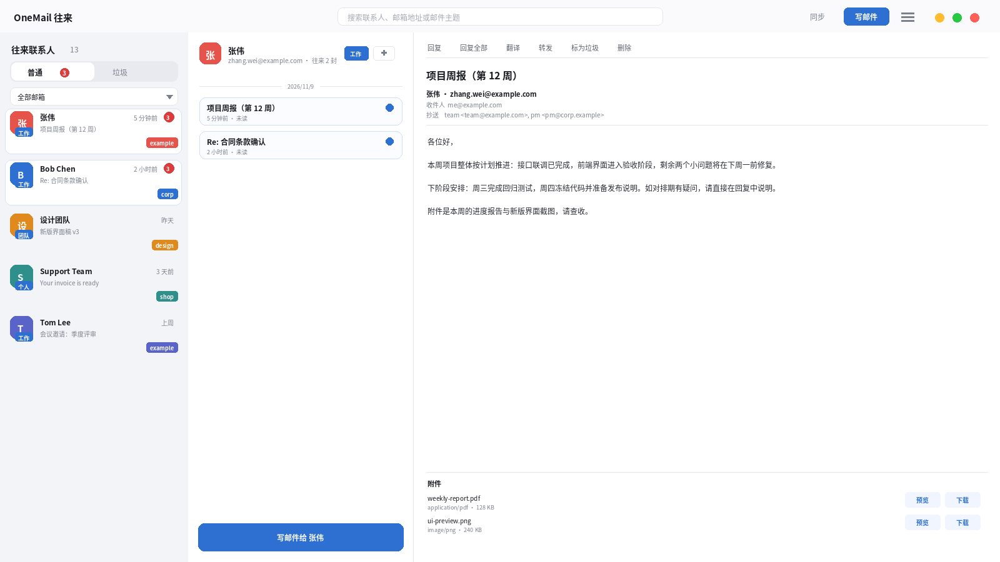

# OneMail 往来

<p align="left">
  
  
  
  
  
  
  
  
</p>

> **项目名：`one-mail-wanglai`** ｜ 界面名：OneMail 往来
>
> **本仓库是 OneMail 的非官方分支（unofficial fork）**
>
> - 上游项目：[zhihui-hu/one-mail](https://github.com/zhihui-hu/one-mail)（Copyright (C) Huzhihui）
> - 本分支：`one-mail-wanglai`（界面名 OneMail 往来）—— 把「按邮箱分组的收件箱」改成「按来往联系人归并的往来时间线」，差异见 [FORK.md](./FORK.md)
> - 授权：[AGPL-3.0-only](./LICENSE)（与上游一致），版权与修改声明见 [NOTICE](./NOTICE)
> - 本分支为个人维护，问题请在本仓库反馈，不要打扰上游作者

OneMail 是一个本地优先的桌面邮件客户端，使用 Tauri 2、Rust、React 和 TypeScript 构建。邮件同步、发送、OAuth、SQLite 数据访问和可选 AI 助手由 Rust 端提供，界面使用 React + Vite。



**语言**：中文 | [English](./README.en.md)

**上游项目主页 / 下载页**：[https://zhihui-hu.github.io/one-mail/](https://zhihui-hu.github.io/one-mail/)（上游内容，非本分支发布）

## ✨ 功能特性

### 往来视图（本分支核心）

- 🧑‍🤝‍🧑 **按人组织，不按文件夹**：左栏一行一个往来邮箱地址，按「最近一封邮件的到达时间」倒序；中栏是该联系人的聊天式往来，右栏是邮件正文。
- 📐 **往来口径**：收到的邮件取**发件人**；自己发出的邮件取**收件人 / 抄送 / 密送**。群发邮件里恰好同列的地址不会被误认成往来人；自己的地址永远排除。
- 🗃️ **普通 / 垃圾两个分组**：垃圾邮件单独灰角标分组，不参与普通组排序；垃圾文件夹默认参与同步，并兼容只给文件夹名（`Spam`、`垃圾邮件`、`廣告`）而不给 `\Junk` 属性的服务器。
- 🏷️ **徽标体系**：账号短徽标显示在头像右下角（可自定义文字 ≤10 字与颜色）；对方邮箱的**一级域名**（`mail.google.com` → `google`）作为自动徽标单独一行右对齐，颜色按首字母轮询，头像底色同套。
- 📝 **联系人备注名**：右键联系人可设备注名，全量重建索引时会保留。

### 账户与同步

- 📬 **多邮箱账号**：Gmail、Yahoo、阿里邮箱/企业邮箱、QQ/Foxmail、腾讯企业邮、网易、Outlook、新浪、139、iCloud、AOL、Yandex、Mail.ru 与自定义 IMAP/SMTP。
- 🔑 **添加即验证**：新增账号会先真实登录一次 IMAP，失败**不入库**并把服务器原话翻译成中文原因（密码错 / 账号不存在 / DNS 解析失败 / 端口不通 / TLS 不匹配 / 未开启 IMAP）。
- 🔄 **同步**：普通 IMAP 按文件夹增量同步，Gmail/Graph 走各自的 delta 通道；同步前会刷新服务器文件夹列表，`INBOX` 与垃圾箱始终启用。
- 📶 **同步进度**：底部状态栏显示「同步中 x/y · 文件夹」。

### 读信

- 📨 **正文**：打开时按需加载；同步结束后会**预取**最近 30 天、单封 ≤5 MB 的正文（每轮最多 40 封），打开基本命中本地缓存。
- 🧭 **邮件被挪走也能打开**：正文取不到时按 `Message-ID` 在该账号**全部服务器文件夹**里重新定位，并把新的文件夹与 UID 回写；仍失败则分段抓取（`HEADER` + 分片 `TEXT`）。
- 🛡️ **HTML 安全预览**：正文 HTML 已净化，默认阻止远程图片与外部资源。
- 📎 **附件可预览、可下载**：图片内嵌预览；其它类型落盘后交系统程序打开；下载保存到 `~/Downloads`（重名自动加序号）。老邮件若缺少附件记录，会自动重新解析补齐。
- 🌐 **逐段翻译**：翻译结果按段落贴在原文下方（沉浸式对照），支持 Google / LibreTranslate / Azure / DeepL 四种后端，可按段落缓存。
- ✅ **已读**：打开即本地标记已读并尝试回写服务器 `\Seen`；服务器不可达时保留本地状态，不回滚。

### MCP（给外部 AI 用）

- 🔌 **内置 MCP 服务**：只监听 `127.0.0.1`，用 Bearer 令牌鉴权；在「设置 → MCP」里一键开关、改端口、重置令牌，并可直接复制客户端的 JSON 配置。
- 🔧 **十一个工具**：`list_accounts`、`mail_status`、`list_correspondents`、`list_messages`、`get_message`、`create_draft`、`update_draft`、`list_drafts`、`delete_draft`、`mark_read`、`send_draft`。
- 🔑 **草稿定位与幂等**：`create_draft` 可带 `clientKey`（重复调用返回同一草稿，不会重复创建）；后续 `update_draft` / `delete_draft` 用 `outboxId` 或 `clientKey` 定位。**已发送的记录不可修改、不可删除**。
- 🔐 **权限分三档**：读取邮件与状态始终允许；**写操作（草稿、标记已读）**可单独开关；**发送邮件默认关闭**，打开后 AI 才能把草稿真正发出去。
- 📎 **附件**：读取时只给元数据；写草稿时可用 base64 附带文件（单个 ≤5MB、合计 ≤10MB），应用落盘保存，发送时会真正带上。

### 桌面与打包

- 🪟 **自绘标题栏**：Linux/Windows 无系统装饰，窗口按钮在右上角，顺序为 最小化 → 最大化 → 关闭；双击标题栏空白处切换最大化。macOS 保留原生交通灯。
- ⚙️ **设置**：主窗口内的模态弹窗（不是独立窗口），含通用、**账号管理**（备注名/短徽标/颜色/暂停同步/移除）、AI、翻译、备份、关于。
- 🔐 **本地凭据加密**：密码/授权码/OAuth token 用 AES-256-GCM 加密后存本地库，密钥在应用数据目录的 `.env`。
- 📦 **Linux deb**：包名 `one-mail-wanglai`，二进制 `one-mail-wanglai`，与上游 `one-mail` 可并存安装、数据互不干扰。

## 🖥️ 界面概览

三栏布局，围绕「人」而不是「文件夹」：

1. **左栏 · 往来联系人**：一行一个邮箱地址，最新往来在最上面；顶部是「普通 / 垃圾」分组 tab（带未读角标）与「全部邮箱」筛选；行内显示名称、最近主题、未读数与徽标。
2. **中栏 · 往来时间线**：该联系人的全部邮件按天分组平铺，未读气泡加粗并带圆点；底部按钮是**写邮件给 TA**（新的独立邮件）。
3. **右栏 · 邮件正文**：工具栏提供回复 / 回复全部 / 翻译 / 转发 / 标为垃圾 / 删除；下方是发件人、收件人、抄送（长列表自动换行）与正文、附件。

交互细则：

- **回复只从气泡右键进入**，会带上原文引用；中栏底部是"写新邮件"，两者语义分开。
- 打开未读邮件即标记已读，左栏角标与气泡样式同步刷新。
- 切换联系人时右栏立即清空，不会残留上一个联系人的邮件。
- 如果这封邮件里该联系人出现在「收件人 / 抄送」栏，正文上方会给出说明，解释它为什么挂在这个人名下。
- 附件：图片「预览」内嵌显示；「下载」保存到 `~/Downloads`；PDF 等交给系统默认程序。

## 🔑 账号授权

- **Gmail**：默认使用系统浏览器完成 Google OAuth；高级选项中也可使用应用专用密码。Google OAuth 运行时需要 `ONEMAIL_GOOGLE_CLIENT_ID`。
- **Outlook / Hotmail**：使用系统浏览器完成 Microsoft OAuth。可通过 `ONEMAIL_MICROSOFT_CLIENT_ID` 覆盖内置桌面客户端 ID。
- **其他内置服务商**：按服务商要求填写密码、应用专用密码、授权码或客户端专用密码。
- **自定义 IMAP**：填写邮箱地址、凭据、IMAP 服务器、端口和安全模式；需要发信时可同时配置 SMTP。
- **文件夹发现**：密码或授权码账号可在保存前测试 IMAP 连接并选择同步文件夹；OAuth 账号当前使用服务商默认同步路径。

---

## 🤖 AI 助手

AI 助手默认未启用，可在 **设置 → AI** 中配置：

- 使用 OpenAI-compatible Chat Completions 接口，填写 Base URL 和模型名称后必须先通过连接验证。
- 远端服务只允许 HTTPS，并需要 API Key；本机 `localhost` 或回环地址可使用 HTTP，且不会使用 API Key。
- API Key 保存在操作系统安全凭据库中，不写入 SQLite 数据库或 `.onemail` 备份。
- 只有用户主动发起请求时，所选邮件的主题、发件人、时间和纯文本内容才会发送给已配置的服务。
- 助手是只读的：可以分析内容和生成草稿，但没有工具权限，也不会直接操作邮件。

---

## 🛠️ 本地开发

### 环境要求

- Node.js 22 或更高版本
- pnpm 10.34.1
- Rust stable 工具链
- 对应平台的 [Tauri 2 系统依赖](https://v2.tauri.app/start/prerequisites/)
- macOS / Windows / Linux 桌面环境

### 安装依赖

```bash
pnpm install
```

### 启动桌面开发模式

```bash
pnpm tauri:dev
# 或
make dev
```

Tauri 会同时启动 Rust 桌面进程和 Vite 开发服务器。若只调试前端页面，可运行 `pnpm dev`。

### 检查与前端构建

```bash
pnpm typecheck
pnpm build
cargo test --manifest-path src-tauri/Cargo.toml
cargo check --manifest-path src-tauri/Cargo.toml
```

`pnpm build` 只生成前端静态资源，不会生成桌面安装包。

### 打包与发布

```bash
pnpm tauri:build
```

也可以运行 `make deploy`；该命令会先按上海时区生成版本号并更新 `package.json`，再构建生产安装包。推送 `v*` 标签会触发 GitHub Actions，为 macOS arm64/x64、Windows x64 和 Linux x64 构建 Tauri 包。

---

## 🎯 使用说明

1. **添加邮箱**：右上角「+」→ 选服务商或自定义 IMAP → 填写地址/端口/授权码。保存前会真实登录验证，失败会给出具体原因，不会留下坏账号。
2. **同步**：保存后自动同步；也可点顶栏「同步」。垃圾箱默认同步，可在设置 → 账号里暂停某个账号的同步。
3. **找往来**：左栏按最近到达时间排序；顶部可切到「垃圾」分组查看被判为垃圾的往来；下拉框可只看某个邮箱的往来。
4. **读邮件**：点中栏气泡 → 右栏显示正文。未读会自动变已读。
5. **回复**：在气泡上右键 →「回复」/「回复全部」，右栏切换为带原文引用的写信界面；底部「写邮件给 TA」则是不带引用的新邮件。
6. **翻译**：点「翻译」→ 每段原文下方出现译文；再点「收起译文」恢复。
7. **附件**：在正文下方点「预览」或「下载」；下载后的文件在 `~/Downloads`。
8. **管理账号**：设置 →「账号」可改备注名、短徽标、徽标颜色，暂停同步或移除账号。
9. **备份**：设置 →「备份」导出 `.onemail` 快照，可再导入恢复。

## 🔐 数据与安全

- OneMail 的数据库位于 Tauri 应用数据目录下的 `OneMail/onemail.sqlite`。
- 邮箱密码、授权码和 OAuth token 不会明文写入数据库，而是使用本地数据库密钥派生的 AES-256-GCM 密钥加密。
- AI API Key 保存在操作系统安全凭据库中；只有用户主动请求时，相关对话和所选邮件内容才会发送到用户配置的 AI 服务。
- `.onemail` 文件是包含完整本地数据库数据和恢复密钥元数据的 SQLite 快照，请按敏感文件妥善保管。
- 导入时会检查 SQLite 完整性、必要表结构、格式版本和备份元数据；旧版 `.sql` 仅作为兼容导入格式保留。
- HTML 邮件会经过基础净化，默认阻止远程图片和外部资源，降低隐私泄露风险。
- 附件正文不自动落盘；点「下载」时才会写到 `~/Downloads`，临时文件放在系统临时目录。

---

## 🚧 当前限制

- **删除只删本地**，不会把邮件从服务器删除或移动到已删除文件夹。
- **标记垃圾只改本地归属**，不做 IMAP MOVE。
- 正文预取窗口是「最近 30 天、≤5 MB、每轮最多 40 封」，更早或更大的邮件仍在打开时按需抓取。
- PDF 附件不内嵌渲染（WebKitGTK 无内置 PDF 插件），点「预览」会用系统程序打开；如需内嵌需集成 pdf.js。
- IMAP 每个已启用文件夹单次最多同步最近 200 封；同步间隔、缓存窗口与开机启动尚未接入系统级行为。
- 远端备份（WebDAV / S3）与自动更新源尚未配置。
- OAuth、IMAP、SMTP、AI 服务的可用性取决于真实账号与服务环境，生产使用前请自行验证。

## 📁 项目结构

```text
src/                              # 前端（React 19 + TS）
├── app/                          # 路由：/ → 往来三栏页
├── components/
│   ├── account/                  # 添加账号对话框与表单
│   ├── settings/                 # 设置弹窗（含账号/翻译分区）
│   ├── mail/                     # 写信、正文渲染等邮件组件
│   ├── window-controls.tsx       # Linux/Windows 自绘窗口按钮
│   └── context-menu.tsx          # 右键菜单（备注名、回复）
├── features/correspondents/      # 左栏联系人、中栏时间线、右栏正文
├── lib/                          # Tauri API 适配、i18n、查询客户端
├── pages/                        # 发件箱 / 账号页等共用页面
└── shared/                       # 前后端共享类型与服务商元数据

src-tauri/src/                    # 后端（Rust）
├── commands/
│   ├── data/                     # 账号、邮件、草稿、联系人、翻译等命令
│   ├── backup/                   # .onemail 导入导出
│   └── system.rs                 # 窗口、日志、路径、设置窗口
├── db/
│   ├── schema.sql                # 表结构（含往来索引三表）
│   ├── correspondents.rs         # 往来索引：重建/增量/排序/徽标
│   └── mod.rs                    # 连接与 SCHEMA_VERSION 迁移
├── mail/
│   ├── sync/                     # IMAP / Gmail / Graph 同步
│   ├── body/                     # 正文抓取、附件、预取
│   ├── transport/                # IMAP 连接与文件夹发现
│   └── smtp.rs                   # 发信
├── translate/                    # 翻译后端（Google / Libre / Azure / DeepL）
├── ai/                           # 只读 AI 助手
└── lib.rs                        # 命令注册、托盘、单实例、窗口事件
```

---

## 📦 技术栈

- [Tauri 2](https://tauri.app/) - 跨平台桌面应用框架
- [Rust](https://www.rust-lang.org/) - 邮件、OAuth、备份与本地数据核心
- [React](https://react.dev/) - 渲染层 UI
- [React Router](https://reactrouter.com/) - 前端路由
- [Vite](https://vite.dev/) - 前端开发与构建工具
- [TypeScript](https://www.typescriptlang.org/) - 类型系统
- [Tailwind CSS](https://tailwindcss.com/) - 原子化样式
- [shadcn/ui](https://ui.shadcn.com/) - UI 组件
- [Lucide React](https://lucide.dev/) - 图标库
- [SQLite](https://www.sqlite.org/) / [rusqlite](https://github.com/rusqlite/rusqlite) - 本地数据存储与原生备份
- [async-imap](https://github.com/async-email/async-imap) / [lettre](https://lettre.rs/) - IMAP 同步与 SMTP 发送
- [mailparse](https://github.com/staktrace/mailparse) - MIME 解析（正文、附件、引用）
- [chrono](https://github.com/chronotope/chrono) - 时间归一化（RFC 2822 → ISO-8601 UTC）
- [pnpm](https://pnpm.io/) - 唯一的包管理器（版本见 `packageManager`）

---

## 🤝 贡献

欢迎提交 Issue 和 Pull Request。提交前请保证下面四条全绿（前端 + 后端 + 类型 + 构建）：

```bash
pnpm typecheck                                        # TS 类型
pnpm test                                             # 前端单测
cargo test --manifest-path src-tauri/Cargo.toml       # Rust 单测
pnpm build                                            # 前端构建
```

## 📄 许可证

本项目采用 [GNU Affero General Public License v3.0](https://www.gnu.org/licenses/agpl-3.0.html)（AGPL-3.0-only）许可。

你可以在遵守 AGPL v3.0 条款的前提下使用、复制、修改和分发本项目；如果通过网络提供修改后的版本，也需要按 AGPL 要求向用户提供相应源代码。

## 🙏 致谢

- [Tauri](https://tauri.app/) - 桌面应用运行时
- [Rust](https://www.rust-lang.org/) - 原生应用核心
- [React](https://react.dev/) - 界面框架
- [Vite](https://vite.dev/) - 开发构建工具
- [shadcn/ui](https://ui.shadcn.com/) - UI 组件库
- [Lucide](https://lucide.dev/) - 图标库
- [SQLite](https://www.sqlite.org/) - 本地数据库

---

**注意**：Gmail 与 Outlook 优先使用系统浏览器 OAuth；其他服务商通常需要先启用 IMAP/SMTP，并按要求使用应用专用密码、授权码或客户端专用密码。

---

## 📌 关于本项目

**one-mail-wanglai** 是桌面邮件客户端 [OneMail](https://github.com/zhihui-hu/one-mail) 的非官方分支，
把「按文件夹/账号分组的收件箱」重做成**按往来联系人组织的三栏视图**：左栏一个人一行（按最近邮件到达时间排序），
中栏是该人的聊天式往来，右栏是邮件正文与附件。

- 往来口径：收到的邮件看发件人；自己发出的邮件看收件人 / 抄送 / 密送
- 普通 / 垃圾两个分组；垃圾文件夹默认同步
- 正文在同步后预取（最近 30 天、≤5 MB），打开不再依赖服务器文件夹状态
- 附件可内嵌预览（图片）、下载到本地；翻译按段落对照显示
- Linux 打 `deb`；macOS / Windows 由 GitHub Actions 自动构建
- 授权：AGPL-3.0-only；与上游 `one-mail` 可并存安装、数据互不干扰
